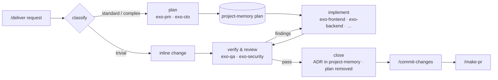

<p align="center">
  
</p>

# Exonous

**A second brain for coding agents.** Install Exonous once per machine and every project you open in a supported AI coding tool gets the same rules, workflow, memory and checks. Hooks enforce them; nobody has to remember them. Nothing is written into your repositories.

> *Exonous*, from Greek ἔξω (*exo*, "outside") + νοῦς (*nous*, "mind"): the mind outside your head.

Coding agents reason brilliantly and forget everything. Each session they re-discover the codebase, re-read whole files to use ten lines, skip the review the team agreed on, and lose the decision made last week. Exonous fixes the parts that instructions alone never fix:

- **Gates agents cannot skip.** Commits, pushes to `main` and force-pushes, and PRs go through a security review, a code review and a PR template check. Hooks in the tool enforce it, not goodwill.
- **A workflow sized to the work.** Trivial changes stay inline; real features go plan → build → verify → review with a fixed roster of agents and compact reports.
- **Memory that does not rot.** Decisions, plans and explanations live in your Obsidian vault, anchored to the exact lines of code they describe, with drift detection.
- **A small, constant context bill.** One always-on rule under 4.5 KB, locate-first code navigation, and nudges away from whole-file reads.

---

## What's inside

Skills and commands have plain English names for what they do. The always-on pieces underneath (the rule, the MCP servers, the hooks and the techne plugin) keep short Greek names.

| Name | Greek | What it does | How you use it |
|---|---|---|---|
| **nomos** | νόμος, law | The single always-on rule: priorities, terse replies, engineering discipline, verification, git gates, the agent roster | Loaded automatically in every session |
| **deliver** | — | Delivery workflow: classify → plan → execute → verify → close | `/deliver <request>` · `/deliver plan …` · `/deliver resume <id>` · `/deliver status` |
| **project-memory** | — | ADRs, plans and docs in your vault, anchored to code, searched offline, with drift checks | Through deliver and session-handoff, or directly: `node ~/.claude/skills/project-memory/project-memory.mjs search "…"` |
| **commit-changes** | — | The only way to commit: leak scan, security review, code review, then a one-shot token | `/commit-changes` |
| **make-pr** | — | The only way to open a PR: template body, ≤ 25 changed files (pure renames don't count) | `/make-pr` |
| **code-review** | — | Code review of local changes or a PR | `/code-review [PR]` |
| **security-review** | — | Security review: secrets, injection, auth, XSS, data exposure | `/security-review` |
| **session-handoff** | — | Session handoff notes in the vault, and resuming from them | `/session-handoff` |
| **doc** | — | Finds which vault docs a session made stale and updates them | `/doc` |
| **issue-board** | — | Your open issues from GitHub Projects, ranked and grouped | `/issue-board` |
| **atlas** | Ἄτλας, the map | Structural code graph (MCP): search symbols, trace calls, fetch exact snippets | `mcp__atlas__*` tools |
| **biblos** | βίβλος, book | Live library and API documentation (MCP) | `mcp__biblos__*` tools |
| **techne** | τέχνη, craft | Stack skills (Vue, React, Go, Python, …), language rules scoped to your stack, quality hooks (Claude Code) | `techne:<stack>` skills, loaded on demand |
| **ui-design** | — | Design direction, critique, audit and polish for any UI work | `/ui-design <command>` |
| **ui-motion** | — | Animation and interaction feel, web and Expo | loaded with ui-design |
| **native-ui** | — | Native platform feel: Apple HIG, SwiftUI, React Native | loaded with ui-design |
| **ui-mockup** | — | Comps, mockups and image-to-code | loaded with ui-design |
| **ui-patterns** | — | Charts, forms, navigation and stack guidelines, subordinate to ui-design | loaded after ui-design sets direction |
| **taxis** | τάξις, order | Hook that allows only the 12 `exo-*` agents, remaps the rest and pins each agent's model tier (Claude Code, Cursor) | automatic |
| **pyle** | πύλη, gate | Hook that gates `git commit`, risky `git push` and `gh pr create` in every gated tool | automatic |
| **metron** | μέτρον, measure | Hook that nudges whole-file reads of large files toward locate-first (Claude Code) | automatic |
| **kairos** | καιρός, the right moment | Session hook: shows the last update note and starts the daily background update | automatic |

Shared skills live once in `~/.agents/skills` (Claude Code gets links in `~/.claude/skills`). The hook runtime lives in `~/.claude/exonous`.

### The agents

Twelve subagents, each fixed to a model tier: planning, review and research run on the economical tier; code is written on the robust one. Claude Code and Cursor get the full roster; OpenCode gets generated `exo-*` agents.

| Agent | Role | Agent | Role |
|---|---|---|---|
| `exo-pm` | requirements, plans, backlog | `exo-backend` | APIs, domain logic, the default implementer |
| `exo-cto` | architecture, ADRs, tech choices | `exo-mobile` | React Native, Swift, Kotlin, Flutter |
| `exo-researcher` | code navigation, docs, research | `exo-data-ai` | schema, queries, pipelines, LLM features |
| `exo-designer` | UX direction, accessibility, design review | `exo-devops` | CI/CD, releases, git hooks |
| `exo-frontend` | web UI (Vue/Nuxt, React/Next, Tailwind) | `exo-infra` | cloud, IaC, Kubernetes, observability |
| `exo-qa` | review, tests, verification gate | `exo-security` | AppSec, auth, secrets, dependencies |

Every agent report starts with one JSON line, `{"status":"done|partial|blocked","cause":"…","risks":[…]}`, so the coordinating session reads results instead of transcripts.

---

## Supported tools

Exonous detects the tools on your machine and wires each one at the level its hook system allows. The tier says what is enforced; a tool is never listed as gated unless its blocking hook is documented.

| Tool | Tier | Rules | Gate | Commands | MCP (atlas, biblos) | Update trigger |
|---|---|---|---|---|---|---|
| Claude Code | gated | `~/.claude/rules` (nomos + stack rules) | `PreToolUse` hook | commands, skills, agents | yes | `SessionStart` |
| Cursor | gated | `nomos.mdc`; **User Rules need a manual paste** (see below) | `beforeShellExecution` hook | skills in `~/.cursor/skills` | yes | `sessionStart` |
| Gemini CLI | gated | `GEMINI.md` import | `BeforeTool` hook | `.toml` commands | copied from Claude Code | `SessionStart` |
| Codex CLI | gated, **approve the hook in `/hooks`** | `AGENTS.md` section | `PreToolUse` hook | `exonous workflow` | `config.toml` block | `SessionStart` |
| OpenCode | gated | `instructions` entry | plugin | commands, `exo-*` agents | copied from Claude Code | `session.created` |
| Windsurf | gated, reduced | `global_rules.md`, short variant, 6000-char cap | `pre_run_command` hook | `exonous workflow` | existing config only | `pre_user_prompt` |
| Copilot | gated, reduced (hooks are Preview) | read from `~/.claude` | `preToolUse` hook | `exonous workflow` | not written | `sessionStart` |
| Cline | rules only, **not gated** | own file in `~/Documents/Cline/Rules` | none | none | none | none |
| Qwen Code | rules only, **not gated** | `QWEN.md` section | none | none | none | none |
| Kiro | detect only, **not gated** | none | none | none | none | none |
| Aider | unsupported | `exonous doctor` prints how to add `read:` by hand | none | none | none | none |
| Roo | unsupported | not detected | none | none | none | none |

Notes:

- **Windsurf** writes only into files that already exist (`~/.codeium/windsurf/hooks.json`, `memories/global_rules.md`, an MCP config), because its paths are moving to Devin Desktop. A missing file is reported at the end of `exonous install` with the fix.
- **Cursor** reads User Rules only from its own settings. Paste `~/.claude/exonous/rules/nomos.md` into Cursor Settings → Rules → User Rules after install and after each release; `exonous doctor` reminds you.
- **Codex CLI** holds the gate until you approve it: open Codex, run `/hooks` and approve the exonous `PreToolUse` hook. Exonous cannot read that approval, so doctor keeps a warning.
- **Gemini CLI, Codex CLI and OpenCode** copy atlas and biblos from Claude Code's registrations. Headers, env values and arguments or URL queries that look like credentials are never copied to another tool.
- **Tools without commands** (Codex, Windsurf, Copilot) learn the procedure from the gate itself: every deny message tells the agent to run `exonous workflow commit` or `exonous workflow pr`, which print the steps.
- Soft-tier tools can commit without a token. `exonous install` and `exonous doctor` say so every time.

---

## Install

Needs Node 18 or newer and git. Install the package globally with your package manager, then run the installer:

```bash
npm i -g github:zaqueu-1/exonous#v2.1.0      # or: pnpm add -g github:zaqueu-1/exonous#v2.1.0
                                              # or: bun add -g github:zaqueu-1/exonous#v2.1.0
exonous install
```

`exonous install` is the contract. The package's `postinstall` also runs it, but only as a best effort: pnpm and bun may skip install scripts, so always run it once yourself. It is safe to re-run.

```bash
exonous install [flags]
  --tools a,b        install exactly these tools (claude, cursor, gemini, codex, opencode, windsurf, copilot, cline, qwen, kiro)
  --all              ignore detection and install every supported tool
  --skip-tool a,b    leave these tools out
  --permissions      Claude Code: pre-approve the read-only helpers `exonous workflow|template|draft-path|validate-pr`
  --rewrite-jsonc    let Gemini CLI and OpenCode configs that contain comments be rewritten as plain JSON (backup kept)
  --dry-run          show what would change
  --quiet            only warnings
```

What it does:

- **Shared:** nomos, the hook runtime in `~/.claude/exonous`, the shared skills and design stack in `~/.agents/skills`, and the atlas and biblos MCP servers.
- **Per tool:** the rows of the table above, written in the tool's own user-level config. Existing content is merged, never replaced: hooks and MCP entries are added next to yours, text rules go inside a marked `exonous:start … exonous:end` section, and a file that is not valid JSON is left untouched with a warning. The first change to a file keeps a `.exonous.bak`.
- **Repositories:** nothing. Exonous never writes `CLAUDE.md`, `AGENTS.md`, `.claude/` or git hooks into a project.

Then point project-memory at your Obsidian vault once per machine:

```bash
echo '{ "vault": "/absolute/path/to/your/vault" }' > ~/.claude/skills/project-memory/config.json
```

Memories live in `<vault>/<repo-name>/memory/{adr,plan,doc}/` as plain Markdown with frontmatter, readable and editable in Obsidian.

---

## How the gates work

An agent cannot commit, force-push, push to `main`/`master` or open a PR until the review happened:

```
/commit-changes → /security-review → /code-review → exonous token commit → git commit
```

| Command | What the gate requires |
|---|---|
| `git commit` | A commit token: `exonous token commit`, minted after the reviews pass. It covers one commit of exactly the tree staged at that moment and expires in 15 minutes. Staging anything afterwards invalidates it. Commits that stage at commit time (`-a`, `-p`, `-i`, `-o`, pathspecs) are refused. If `gitleaks` is installed the staged changes are scanned (a finding blocks; without it you get a warning). |
| `git push` | Nothing for an ordinary branch. A force-push or a push to `main`/`master` is refused unless the user asked for it and `exonous token push` was minted for the exact commits being pushed. Pushes touching every branch and branch deletions are always refused. |
| `gh pr create` | The body must contain every section title of the PR template and the PR must change at most 25 files. The template is the repo's own `pull_request_template.md` when it has one, else the bundled one (`exonous template` prints it, `exonous validate-pr <file>` checks a draft). |

Rules of the road:

- The gated command must run **alone**, optionally after one `cd <dir> &&`. Chained, piped or computed forms near `git`/`gh` are refused, and input the gate cannot parse is refused when it mentions git or gh.
- A refusal says why and names the next step (`exonous workflow commit` or `exonous workflow pr`).
- Tokens live in `~/.claude/exonous/state`, one per repo, and are consumed on use.
- Commits you make yourself in a terminal are not gated: the hooks sit inside the tools, not in git.

**This is a speed bump for agents, not a sandbox.** It stops the honest mistake, skipping the review, and makes the correct path the easy one. It does not stop an agent determined to route around it. Known gaps: a script or build tool that runs `git commit` or `gh pr create` inside itself (`npm run release`, `make`), commits created by `merge`, `rebase` or `cherry-pick`, and PRs opened through `curl`, the API or `gh` extensions. An agent that can run `exonous token commit` can also mint a token without reviewing; with `--permissions`, Claude Code still asks you before it runs that command.

---

## A day with Exonous



1. **Start a task:** `/deliver add rate limiting to the public API`. It looks up related decisions with project-memory, classifies the work and states the branch strategy. Trivial work is done inline. Larger work gets a plan, saved as a project-memory `plan` so it survives the session.
2. **Build and verify:** implementers get a compact packet (goal, files, done-checks), and gate agents fetch the diff themselves. Revision rounds go back to the same agent, and the loop stops after two rounds without progress.
3. **Close:** decisions become ADRs anchored to code, and the executed plan is removed.
4. **Ship:** `/commit-changes` runs `/security-review` and `/code-review`, mints the token and commits. `/make-pr` opens the PR from the template.
5. **Stop for the day:** `/session-handoff` writes a handoff note to the vault; `/session-handoff resume` picks it up tomorrow.

The same flow works in any gated tool; where there is no `/commit-changes` command, the agent follows `exonous workflow commit`.

---

## Updates

Updates are automatic and silent:

- At most once a day, kairos starts `exonous update` in the background when a session opens in any gated tool, so it never delays you. All tools share one throttle and one lock.
- It resolves the newest `vX.Y.Z` tag of the same major to its commit, installs exactly that commit with the package manager recorded at install time (`npm i -g`, `pnpm add -g` or `bun add -g`), verifies the package name, version and, where the package manager's lockfile records it, the commit, then runs `exonous install --quiet` from the new copy.
- Installed hooks change only if the whole install succeeds. A failure backs off for a day and leaves details in `~/.claude/exonous/state/update.log`.
- Files a release dropped are removed from every tool, except ones you edited.
- The next session shows one line: `exonous updated v2.1.0 → v2.1.1 (restart to load new hooks)`.
- A new major is announced once and never applied by itself.

```bash
exonous update            # update now
exonous update --check    # just tell me
exonous update --major    # cross to a new major
```

A package installed from a branch or commit (not a release tag) is never auto-updated. `exonous doctor` warns if a release tag was moved after you installed it.

**Opt out** with any of: `EXONOUS_NO_UPDATE=1` in the environment, `CI` set, or `{ "autoUpdate": false }` in `~/.claude/exonous/config.json`.

## Migrating from repo installs

Exonous v2.0.0 and `@tron/claude-config` installed as a `devDependency` and wrote files into each repo. That mode is retired. When such a copy updates or installs, it moves itself to the machine install:

1. runs the machine install from that copy, tries to add a pinned global copy with your package manager (a failure only warns), then checks that the gate hook is registered;
2. only then removes the repo files it wrote: hook scripts, git hooks, `AGENTS.md`, stack rules, scope files. A file you edited is kept and listed, and in `.claude/settings.json` and hook configs only exonous entries are stripped;
3. removes the `exonous` (or `@tron/claude-config`) devDependency with your package manager when `package.json` and the lockfile have no other uncommitted changes; otherwise it tells you to run `exonous migrate`.

If the machine install does not pass the check, the repo is left untouched. Tracked files that were removed show up in `git status` for you to commit.

```bash
exonous migrate [--repo <dir>]    # run it by hand in a repo; safe to repeat
```

Opt out of the automatic path with `EXONOUS_NO_INSTALL=1` or `{ "autoInstall": false }` in `~/.claude/exonous/config.json`.

`/tron-flow` keeps working as an alias for `/deliver` for one release.

## Doctor and uninstall

```bash
exonous doctor                    # coverage matrix, then every check with the exact fix
exonous gate --selftest <tool>    # run one tool's gate script against a fake commit
exonous uninstall                 # asks first; --yes skips the prompt, --dry-run previews
```

`exonous doctor` prints one row per tool with its tier and whether rules, gate, commands, MCP and update trigger are in place (`hard (registered, selftest ok)`, `soft: not enforced`, `not installed`, `skipped`). Rows marked `⚠` are things exonous cannot verify, such as Cursor User Rules or the Codex `/hooks` approval; they are not failures. The exit code is 1 only when a check fails.

The gate self-test pipes a fake `git commit` to the hook command registered in the tool's config and expects a refusal. It proves the wiring and the script work. It does not prove the tool loads the hook, which is why the tool's own approval step (Codex) and a real commit attempt are still worth one try.

`exonous uninstall` removes only what install wrote: ledger files, owned hook and MCP entries, marked rule sections, links, the runtime and the techne plugin. It keeps your `config.json`, the atlas and biblos MCP registrations and your skill config files, and leaves any `.bak` it made. Add `--remove-package` to also run the package manager's global remove; otherwise the last line tells you the command.

## Configuration

`~/.claude/exonous/config.json` (all keys optional):

| Key | Effect |
|---|---|
| `autoUpdate: false` | no automatic updates |
| `autoInstall: false` | no automatic migration of repo-mode installs |
| `disabledTools: ["cline", …]` | tools skipped by a plain `exonous install` |

| Environment | Effect |
|---|---|
| `EXONOUS_NO_UPDATE=1` | skip the daily update check |
| `EXONOUS_NO_INSTALL=1` | skip automatic repo-mode migration |
| `CI` | no automatic update or install from `postinstall` |
| `EXONOUS_HOME=<dir>` | treat `<dir>` as the home to read and write (for trying exonous safely); global package-manager calls and the claude CLI are skipped |
| `COPILOT_HOME=<dir>` | where Copilot's hook file goes, as Copilot reads it |

## Privacy

Exonous has no telemetry. Its network use is: the daily `git ls-remote` against `github.com/zaqueu-1/exonous` and the package-manager install when an update exists; on first install, a checksum-verified download of the atlas code-graph engine from GitHub (skipped when it is already present). Nothing is sent about you or your code.

MCP registrations copied from Claude Code to other tools carry only the command and arguments (or an `https` URL). Headers and env values are never copied, and an entry whose arguments or URL query look like a credential is skipped with a warning.

---

## Repository layout

```
bin/exonous.js     CLI: install · update · doctor · uninstall · migrate · token · workflow · template · draft-path · validate-pr
src/               installer, updater, doctor, uninstall
  adapters/        one module per tool
  lib/             ledger, settings and marker writers, rule variants, converters
  legacy/          repo-install migration and the tron bridge (temporary)
assets/
  rules/           nomos
  agents/          exo-* agents, roster, taxis
  skills/          deliver project-memory commit-changes make-pr code-review security-review session-handoff doc issue-board ui-design ui-motion native-ui ui-mockup ui-patterns
  techne/          the techne plugin: stack skills, language rules, quality hooks
  machine/         hook runtime copied to ~/.claude/exonous, PR template
  adapters/        generated-file templates (OpenCode plugin)
  editors/         Cursor rule and hook templates
test/              npm test
docs/              cover, maintainer guide
maintainer/        upstream provenance (pege), mirror and manifest tooling, never shipped
```

Maintainers: releases, adapters, guards and upstream tracking are in [docs/MAINTAINING.md](docs/MAINTAINING.md).
